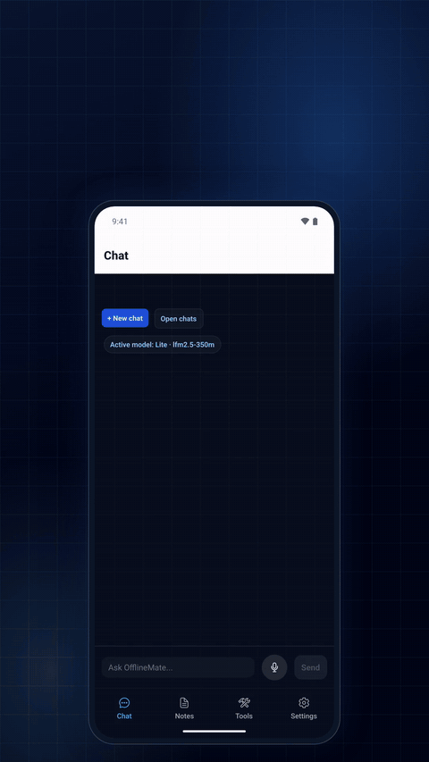
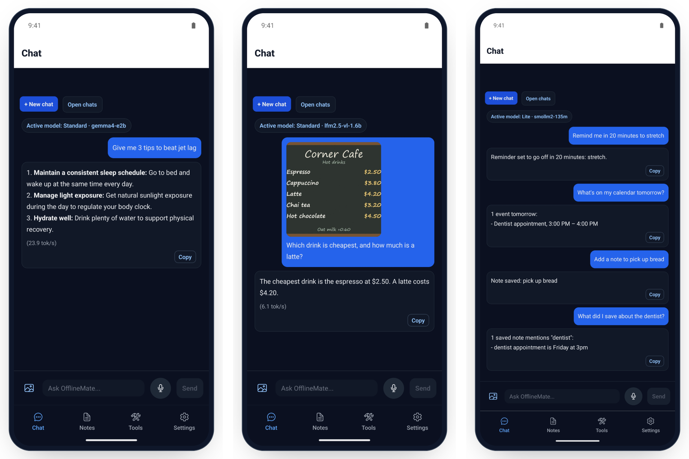
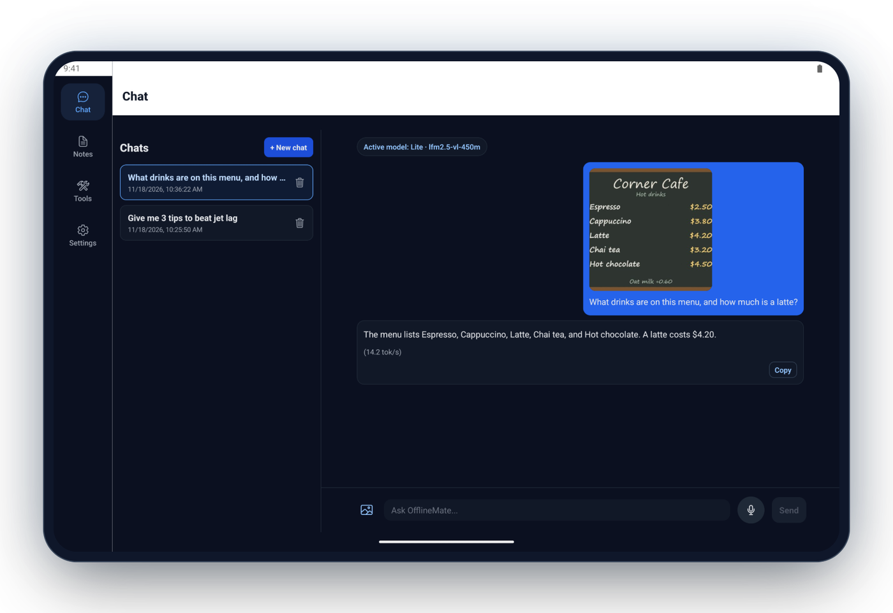
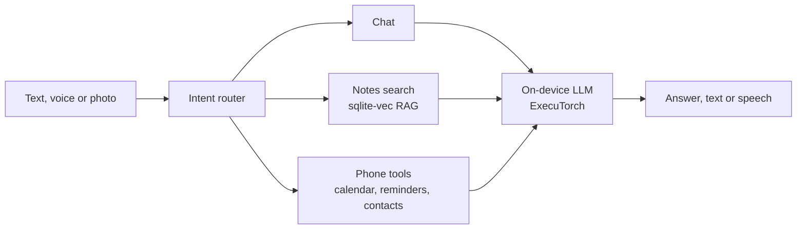

<p align="center">
  
</p>

<h1 align="center">OfflineMate</h1>

<p align="center">
  <strong>A private AI assistant that runs entirely on your phone.</strong><br />
  Chat, ask about photos, talk to it, and manage notes, reminders and your calendar, all in airplane mode.
</p>

<p align="center">
  <a href="https://play.google.com/store/apps/details?id=com.offlinemate.app"></a>
  <a href="https://github.com/KingPegasus/OfflineMate/actions/workflows/ci.yml"></a>
  
  
  <a href="LICENSE.md"></a>
</p>

<p align="center">
  <a href="https://offlinemate.com">Website</a> ·
  <a href="https://offlinemate.com/#media">Videos</a> ·
  <a href="https://offlinemate.com/models.html">Choosing a model</a> ·
  <a href="docs/README.md">Docs</a> ·
  <a href="CHANGELOG.md">Changelog</a>
</p>

<p align="center">
  
</p>

---

## Quick start

**Just want to use it?** Install it free from **[Google Play](https://play.google.com/store/apps/details?id=com.offlinemate.app)**. On first launch it suggests a model tier for your phone; download it once (about 430 MB on Lite), turn on airplane mode, and ask something.

**Want to build it?** You need Node 24+, JDK 17 and the Android SDK ([full setup](BUILDING.md)). With a phone plugged in or an emulator running:

```bash
git clone https://github.com/KingPegasus/OfflineMate.git && cd OfflineMate
npm ci
npx expo run:android --variant release
```

The app installs and opens on the device. Pick a tier, let the model download, and send your first message. Nothing after that needs a connection.

---

## What it does

<p align="center">
  
</p>

| | |
|---|---|
| 💬 **Offline chat** | Answers are generated on the phone by a small language model. No account, no server. |
| 🖼️ **Ask about a photo** | Pick a photo and ask about it: read a menu, a sign, a chart. The image never leaves the device. |
| 🎙️ **Voice** | Hold to speak, with on-device speech-to-text, and have answers read aloud. |
| 📝 **Notes with memory** | Save notes, then ask "what did I save about the dentist?" Semantic search (RAG) finds them by meaning. |
| 🛠️ **Phone tools** | "Remind me in 10 minutes", "what's on my calendar tomorrow", "set an alarm for 7", "what's Mom's number". Only with the permissions you grant. |
| 📱 **Any phone** | Lite, Standard and Full tiers fit phones from 3 GB to 12+ GB of RAM. |
| 🗂️ **Tablets and foldables** | Side-by-side layouts on tablets, and on foldables when unfolded or half-open. |

### Tablets and foldables

On a tablet, a side rail replaces the bottom tabs and your chats sit beside the conversation. Foldables switch between the phone and tablet layouts as you fold and unfold, without losing what you typed. Half-open, the screen splits at the fold so nothing sits under the hinge ([foldable screenshots](docs/foldable/)).

<p align="center">
  
</p>

### What goes online, and what doesn't

| Stays on your phone | Uses the network |
|---|---|
| Chats, notes, photos you ask about, voice, the AI models once downloaded, reminders, calendar and contacts lookups | The one-time model download from Hugging Face. Optional **web search** (DuckDuckGo) and **weather** (Open-Meteo), which send only the query or place name. One switch in Settings turns both off. |

Details: [privacy policy](docs/legal/privacy-policy.md).

### Which tier fits your phone

| Tier | Phone RAM | Default model | Download | Notes search |
|---|---|---|---|---|
| Lite | 3–4 GB | SmolLM2 135M | ~430 MB | — |
| Standard | 6–8 GB | Gemma 4 E2B | ~2.5 GB | ✅ |
| Full | 10–12+ GB | Qwen 3 4B | ~2.6 GB | ✅ |

Each tier also offers alternatives (Llama 3.2, LFM 2.5, Qwen 3.5, MiniCPM5) and vision models for photo questions. See [how to choose a model](https://offlinemate.com/models.html).

> Phone-sized models are less capable than large cloud models and can make mistakes. Check anything important.

---

## How it works



Built with **Expo / React Native**, **[react-native-executorch](https://github.com/software-mansion/react-native-executorch)** for on-device inference, **sqlite-vec** for vector search, and on-device speech-to-text. The step-by-step pipeline is in [input and tooling flow](docs/architecture/input-and-tooling-flow.md); the full index is in [`docs/`](docs/README.md).

---

## Development

```bash
npm run typecheck      # TypeScript
npm run lint           # ESLint
npm test               # unit, integration and e2e tests (Vitest)
npm run validate       # everything CI runs, plus the audit
```

| Topic | Where |
|---|---|
| Local builds, Android SDK setup, EAS | [`BUILDING.md`](BUILDING.md) |
| iOS simulator build (macOS, in progress) | [`BUILDING.md` § 5a](BUILDING.md#5a-local-ios-simulator-build-macos) |
| Release and Play Store | [`docs/deployment/`](docs/deployment/) |
| Website ([offlinemate.com](https://offlinemate.com)) | [`website/README.md`](website/README.md) |
| Pre-commit hook | [`docs/pre-commit.md`](docs/pre-commit.md) |
| Roadmap | [`docs/ROADMAP_AND_GAPS.md`](docs/ROADMAP_AND_GAPS.md) |

## Contributing

Issues and pull requests are welcome. Read [`CONTRIBUTING.md`](CONTRIBUTING.md) first, and report security problems privately as described in [`SECURITY.md`](SECURITY.md).

## License

[MIT](LICENSE.md). Privacy policy and terms are in [`docs/legal/`](docs/legal/README.md).

OfflineMate is built and maintained by [Rhyme Solutions](https://rhymesolutions.com/) · [YouTube](https://youtube.com/@rhymesolutions) · [LinkedIn](https://www.linkedin.com/company/rhymesolutions) · [Instagram](https://www.instagram.com/rhymesolutions/)
